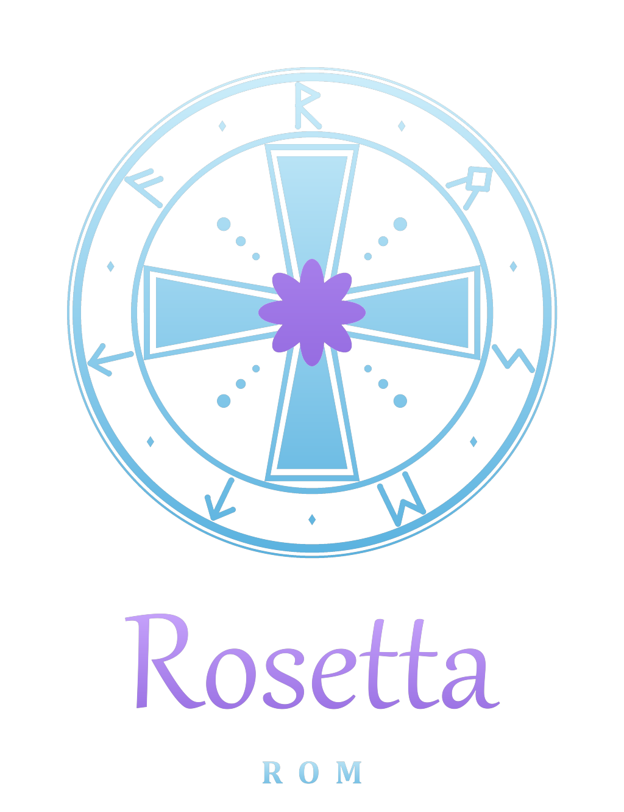
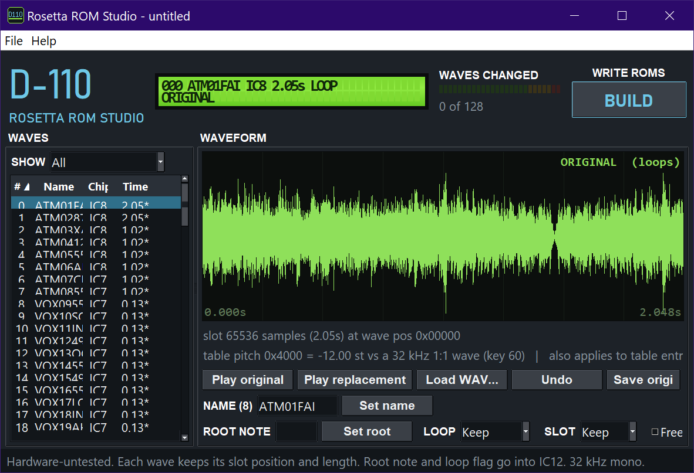
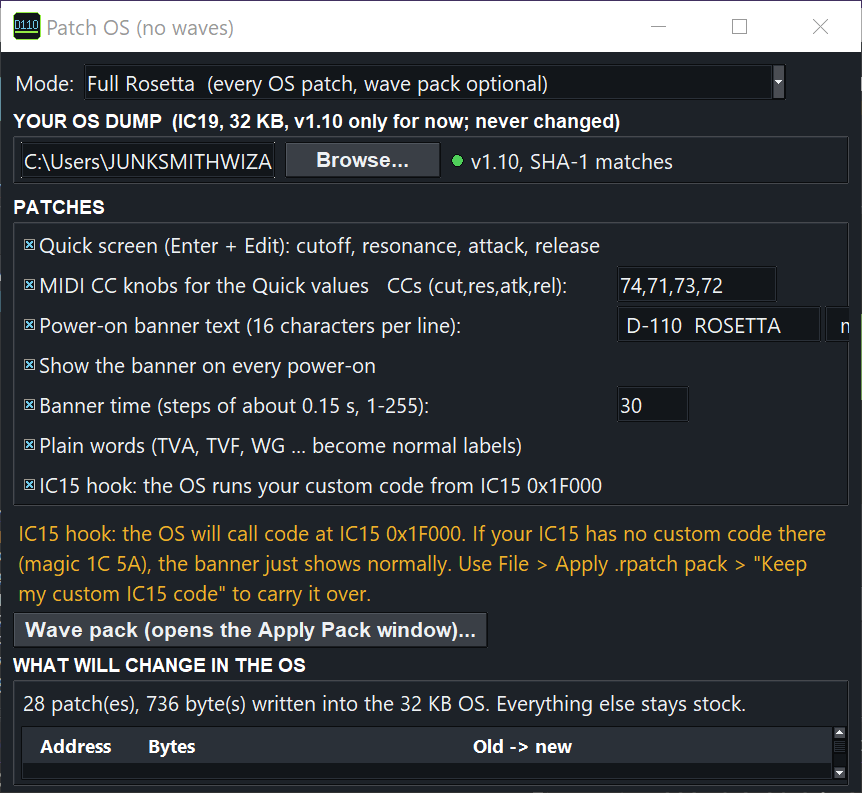

# D-110 Rosetta OS

> *"You can't teach an old dog new tricks, but you can feed it only crack and steroids for a week."*

**New tricks for the Roland D-110.** Rosetta OS is a patch kit for the stock **OS v1.10**: an arpeggiator and step
sequencer, MIDI out, chords and scale chords, unison, mono and glide, a mod matrix, Wavestation-style wave
sequencing, vintage drift, and a **Lab** that pokes the LA32 chip into sounds Roland never let out. It all runs from
a menu on the front panel. You bake it into **your own** ROM dumps and burn two chips: the socketed OS EPROM (IC19)
and the control ROM (IC15). Put the old chips back and it's a stock D-110 again.

> **Made by JunkSmithWizard (JSW) together with Claude (Anthropic's AI).** Claude wrote the code and did the reverse
> engineering: an MCS-96 disassembler, assembler and simulator built for the 8097 CPU, then the OS hooks.
> JSW burned every build into a real D-110, played it, and made the calls by ear.
> Same family as the [GP-16](https://github.com/yuyoi/super-Gp-16-Rosetta-OS),
> [S2000](https://github.com/yuyoi/Akai-S2000-Rosetta-OS) and
> [SP-808](https://github.com/yuyoi/Sp-808-rosetta-looper-OS-) Rosetta OSes.
> Your own waves for the D-110 come from [Rosetta ROM](https://github.com/yuyoi/Rompler-RosettaRom).

## Rosetta ROM Studio

The PC side: swap the D-110's waves for your own samples, then patch the OS, all in one app. It lives in the
[Rosetta ROM](https://github.com/yuyoi/Rompler-RosettaRom) repo; this repo is the OS code it bakes in.

The wave editor (here with a custom wave bank loaded): pick a wave, load a WAV, set name, root note and loop, BUILD writes the ROMs.

Patch OS: your v1.10 IC19 dump in, pick the patches, and it lists every byte it will change. Your dump is never touched.

## What it adds

| Feature | Status |
|---|---|
| **Rosetta menu** on the front panel, every setting kept in battery RAM (survives power-off) | ✅ on hardware (v12) |
| **Arpeggiator**: Up, Down, Up+Down, Random, Played, Seq; octaves, rate 1/4-1/32, gate, latch, humanize, ratchets, accents, Euclid patterns, chance %. Syncs to MIDI clock | ✅ on hardware (v12) |
| **Step sequencer**: up to 32 steps (notes, rests, ties), step or live recording, transposed by the last key held | ✅ on hardware (v12) |
| **MIDI out** of the arp notes on the arp part's channel | ✅ on hardware (v12) |
| **Chords**: fixed shapes, **Chord Learn** (play a chord once, one key plays it), **Scale / Scale 7** (one key = the triad or 7th of the key and scale) | ✅ on hardware (v12) |
| **Unison** (1-4 voices with detune), **Mono / Legato**, **Glide** | ✅ on hardware (v12) |
| **Mod Matrix**: 4 slots; ModWheel, aftertouch, velocity, key, LFO, S&H, CC16/17 to cutoff, pitch, wave, level, reso. LFO syncs to MIDI clock | ✅ on hardware (v12) |
| **Wave Seq** (Wavestation style: each note steps through PCM waves), **Wave Scan** on CC70, **Random** wave / pitch / cutoff per note | ✅ on hardware (v12) |
| **Vintage**: every note drifts in pitch and cutoff on its own, like an old analog | ✅ on hardware (v12) |
| **Lab**: resonance past the stock maximum, control-byte and PCM-position XORs, **Lab Motion** that sweeps them in time | ✅ on hardware (Reso High + Ctrl XOR since v8); the PCM items are experimental |
| **Quick screen** (Enter + Edit): cutoff, resonance, attack, release of the whole part, live | ✅ on hardware (IC19 only, v6) |
| **MIDI CC knobs** for the Quick values (CC74 / 71 / 73 / 72 by default) | ✅ on hardware (IC19 only, v6) |
| **Plain words** (WG, TVF, TVA ... become OS, Flt, Amp ...) and your own **boot banner** | ✅ on hardware (IC19 only, v6) |

Every control and value is in the **[user guide](USER_GUIDE.md)** (also as a page: [`docs/rosetta-manual.html`](docs/rosetta-manual.html)).

## Two ways to run it

| | Chips | You get |
|---|---|---|
| **Quick mod** | IC19 only (one socketed EPROM) | Quick screen, CC knobs, plain words, boot banner. Stock IC15 / IC7 / IC8 |
| **Full Rosetta** | IC19 + IC15 | everything in the table above |

IC19 is the same from v8 to v12, so a new Rosetta version only needs IC15 reburned. With a stock IC15 the unit
simply runs as a D-110 with the Quick mod.

## Quick start

1. Read your own **IC19** (27C256-type EPROM) and **IC15** (LH5310 mask ROM) on a programmer such as a T48.
   Keep the originals.
2. Put the dumps in `roms/IC19 (main OS EPROM)/` and `roms/IC15 (bin from Rosetta Studio here)/` (or use the IC15
   file Rosetta ROM Studio made, if you also swapped waves).
3. Run `python bake_rosetta.py --test`. It checks your dumps, runs the simulator tests, and writes the burn files
   plus `BURN.txt` (with MD5s) to `baked/`.
4. Burn IC19 to a 27C256 (or a W27C512 / 27C512 with the doubled image) and IC15 to an SST39SF040 on an adapter.
   Read back, compare the MD5s, fit the chips.
5. Power on: **` ROSETTA OS v12 ` / ` D-110  by JSW `** means both chips are right. On the Quick screen
   (hold **Enter**, press **Edit**), **Edit** again opens the Rosetta menu.

IC15 socket wiring and the drop-in module: [`HARDWARE.md`](how-to-reverse-engineer/HARDWARE.md) and
[`IC15_MODULE.md`](how-to-reverse-engineer/IC15_MODULE.md). IC19 only? `patch_ic19.py` does the Quick mod on
its own (see the [dev log](docs/DEVLOG.md#d-110-os-mod-v6-one-eprom-swap-ic19-only)).

## For developers

| File | |
|---|---|
| `rosetta.py`, `test_rosetta.py` | the Rosetta code (IC19 hooks + IC15 code) and its simulator tests |
| `bake_rosetta.py`, `roms/` | the ROM baker: your dumps in, burn files out |
| `patch_ic19.py`, `ic19_quick.py`, `test_ic19_quick.py` | IC19 patcher (Quick screen, CC knobs, plain words, banner, Rosetta hooks) |
| `patch_ic15.py` | puts the Rosetta code into your own IC15 image |
| `mcs96_asm.py`, `mcs96_dis.py`, `mcs96_sim.py` | MCS-96 assembler, disassembler + flow tracer, and simulator |
| `IC19_MAP.md`, `IC12_MAP.md` | maps of the OS ROM and the control ROM: hooks, RAM, routines |
| [`how-to-reverse-engineer/`](how-to-reverse-engineer/README.md) | the method, rules and pitfalls, for people (or AI models) working on the OS |
| [`docs/DEVLOG.md`](docs/DEVLOG.md) | the old README: per-version notes, build flags, findings |

The disassembly listing comes from Roland's code, so it's gitignored and stays on your machine.

## Status: work in progress 🚧

v12 boots and works on a real D-110, and Rosetta has already been used in real music sessions. Keep your old chips or v9/v11 files as a
fallback.

**Planned:**
- A **D-10** port ([`PORT_D10.md`](how-to-reverse-engineer/PORT_D10.md)).
- **Rosetta Lite**: more of the OS on IC19 alone, no IC15 swap.

Ideas, bug reports and test results are very welcome. Open an issue.

## Legal

Not affiliated with or endorsed by Roland Corporation. "Roland" and "D-110" are trademarks of their owners. This
repo contains **no Roland code or ROM data**: you read your own chips and the tools add the new bytes. Please don't
share patched or baked .bin files; share this repo instead. Burn at your own risk, and always keep your original chips.

License: MIT (see `LICENSE`).

---

**Thanks for enjoying, and God bless you!** — JSW
